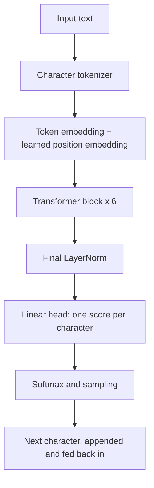
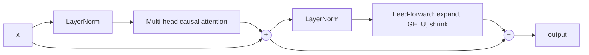

# mini-gpt-from-scratch
A from-scratch GPT (decoder-only Transformer) in PyTorch trained on TinyShakespeare. Multi-head causal attention, 10.8M params, with training logs and an overfitting analysis.

[](https://colab.research.google.com/drive/12jRWKGL40IlP-Kesv2ciRU8kONJcZ5Od?usp=sharing)


A small GPT-style, decoder-only Transformer written in plain PyTorch and trained from scratch on the TinyShakespeare dataset to predict the next character. The whole model fits in one notebook and every component (tokenization, embeddings, multi-head causal attention, Transformer blocks, training loop, text generation) is implemented and commented by hand.

> **This is an educational project, not a chatbot.** The model continues text in the style of its training data. It does not answer questions. See [Limitations](#limitations).

---

## Table of Contents

1. [Why this project](#why-this-project)
2. [Results at a glance](#results-at-a-glance)
3. [Sample output](#sample-output)
4. [Architecture](#architecture)
5. [Model configuration](#model-configuration)
6. [How it works](#how-it-works)
7. [Training results and overfitting analysis](#training-results-and-overfitting-analysis)
8. [Quickstart](#quickstart)
9. [Generating text with the trained model](#generating-text-with-the-trained-model)
10. [Repository structure](#repository-structure)
11. [Hyperparameter guide](#hyperparameter-guide)
12. [Limitations](#limitations)
13. [Improvements and roadmap](#improvements-and-roadmap)
14. [What this project demonstrates](#what-this-project-demonstrates)
15. [References and acknowledgements](#references-and-acknowledgements)
16. [License](#license)

---

## Why this project

Large Language Models can feel like black boxes. The goal of this project is to open the box: build a miniature GPT from first principles, train it end to end, and observe how the pieces behave (loss curves, overfitting, sampling temperature, the effect of the causal mask).

The architecture follows the same recipe used by modern LLMs, only much smaller:

- Token and positional embeddings
- Stacked Transformer blocks with **multi-head causal self-attention**
- Pre-LayerNorm, residual connections, and a GELU feed-forward network
- Next-token prediction with cross-entropy loss
- Autoregressive text generation with temperature and top-k sampling

## Results at a glance

| Item | Value |
|---|---|
| Dataset | TinyShakespeare (1,115,394 characters, vocabulary of 65) |
| Tokenization | Character-level |
| Parameters | **10.77 M** |
| Layers / heads / embedding size | 6 / 6 / 384 |
| Context length | 256 characters |
| Hardware | Google Colab GPU |
| Training time | about 38.6 minutes for 5,000 steps |
| Random-guess loss | 4.17 (= ln 65) |
| Best validation loss | **1.463** (step 1,500) |
| Final train / validation loss | 0.344 / 2.029 (overfit, see [analysis](#training-results-and-overfitting-analysis)) |

## Sample output

Text generated by the final checkpoint (temperature 0.8, top-k 40):

```text
But now the king shall forbear the lives.

KING RICHARD III:
So:
What am I sabel, I come hither, sir?

DUKE OF AUMERLE:
Comfort, my liege; remember who you are.

KING RICHARD II:
Ay, but thou wilt say to me, I say.

DUCHESS OF YORK:
Why, brother, I cannot tell it so,
I am content: but 'tis thy wisdom to come;
```

The model has learned the *format* of a play (speaker names in capitals, colons, line breaks, verse-like lines) and mostly produces real words. The content is not coherent, which is expected for a 10.8M-parameter model trained on about 1 MB of text. Because the final checkpoint is overfit, parts of the output may be memorized rather than newly composed.

## Architecture



Each Transformer block (pre-norm style):



The attention step computes, for every head:

```
Attention(Q, K, V) = softmax( Q · Kᵀ / √d ) · V
```

with a lower-triangular **causal mask** so each position can only look at itself and earlier positions.

## Model configuration

The notebook picks a preset automatically. The `gpu` preset was used for the reported results.

| Setting | `cpu` preset | `gpu` preset | Meaning |
|---|---|---|---|
| `block_size` | 64 | **256** | Context window (characters the model sees at once) |
| `batch_size` | 32 | **64** | Training examples per step |
| `n_layer` | 4 | **6** | Number of stacked Transformer blocks |
| `n_head` | 4 | **6** | Attention heads per block |
| `n_embd` | 128 | **384** | Size of each token vector (64 per head on the GPU preset) |
| `max_iters` | 3000 | **5000** | Training steps |
| `lr` | 1e-3 | **6e-4** | Peak learning rate |

Shared settings: dropout 0.1, AdamW with weight decay 0.1, 100 warmup steps then cosine decay to 10% of the peak rate, gradient clipping at 1.0, evaluation every 250 steps (averaged over 50 batches), tied input and output embeddings.

## How it works

**1. Data.** The text file is read, and every unique character becomes one vocabulary entry (65 in total). `stoi` maps characters to integers and `itos` maps back. The full text is converted to one long tensor and split 90% train, 10% validation.

**2. Batches.** `get_batch` picks random starting positions and cuts out chunks of `block_size` characters. The target is the same chunk shifted one character to the right, so a single chunk provides `block_size` training predictions at once.

```
x = [ T  h  e  _  c  a  t ]
y = [ h  e  _  c  a  t  _ ]     (each y is the "next character" for the same position in x)
```

**3. Model.** Characters are turned into vectors (token embedding plus position embedding), passed through the stack of Transformer blocks, normalized, and projected to 65 scores, one per possible next character.

**4. Training.** For each step the model predicts the next characters, cross-entropy loss measures how wrong it was, backpropagation computes gradients, and AdamW updates the weights.

**5. Generation.** Starting from a prompt, the model predicts a probability distribution for the next character, one character is sampled (after applying temperature and top-k filtering), it is appended to the text, and the process repeats.

## Training results and overfitting analysis

Selected evaluation points from the run (loss in nats per character):

| Step | Train loss | Validation loss | Note |
|---|---|---|---|
| 0 | 4.245 | 4.239 | Near random guessing (4.17) |
| 250 | 2.019 | 2.101 | |
| 500 | 1.519 | 1.699 | |
| 1000 | 1.250 | 1.518 | |
| **1500** | **1.114** | **1.463** | **Best validation loss** |
| 2000 | 0.978 | 1.513 | Validation starts rising |
| 3000 | 0.678 | 1.691 | |
| 4000 | 0.450 | 1.900 | |
| 5000 | 0.344 | 2.029 | Final checkpoint |

**What happened.** Training loss kept falling for the whole run, but validation loss reached its minimum around step 1,500 and then climbed. This gap is classic **overfitting**: the model stopped learning general patterns of the language and began memorizing the training text.

**Why it happened.** The dataset is only about 1 MB, while the `gpu` configuration processes roughly 82 million characters over 5,000 steps. That is about 80 passes over the training split, and a 10.8M-parameter model has more than enough capacity to memorize it.

**The takeaway.** The best model in this run is the one from around step 1,500, not the last one. The notebook currently saves only the final checkpoint, so the saved model is the overfit one. See [Improvements](#improvements-and-roadmap) for the fix.

> A character-level loss of 1.46 corresponds to a perplexity of about 4.3 (the model is, on average, as uncertain as choosing between roughly four characters). The final validation loss of 2.03 corresponds to a perplexity of about 7.6.

## Quickstart

### Option A: Google Colab (recommended)

1. Click the **Open in Colab** badge at the top of this README.
2. Choose **Runtime, Change runtime type, GPU**.
3. Choose **Runtime, Run all**. The dataset downloads automatically.

Expect roughly 40 minutes for the full 5,000 steps on a Colab GPU. For a faster first run, set `MAX_ITERS` to 1500 before the config cell:

```python
import os
os.environ["MAX_ITERS"] = "1500"
```

### Option B: Run locally

```bash
git clone https://github.com/<your-username>/mini-gpt-from-scratch.git
cd mini-gpt-from-scratch
pip install -r requirements.txt
jupyter notebook Mini_GPT.ipynb
```

Requirements: Python 3.9+ and PyTorch 2.0+ (the code uses `F.scaled_dot_product_attention`). A CUDA GPU is recommended. The `cpu` preset runs on a laptop with a smaller model (about 0.8M parameters) in a few minutes.

## Generating text with the trained model

After training, the model stays in the notebook's memory. Run this in a new cell:

```python
def complete(prompt, n=300, temperature=0.8, top_k=40):
    prompt = "".join(c for c in prompt if c in stoi)   # drop characters never seen in training
    if not prompt:
        prompt = "\n"
    ids = torch.tensor([encode(prompt)], dtype=torch.long, device=device)
    model.eval()
    out = model.generate(ids, max_new_tokens=n, temperature=temperature, top_k=top_k)
    return decode(out[0].tolist())

print(complete("ROMEO:"))
```

Tips:

- Use prompts that look like the training data (`ROMEO:`, `KING RICHARD II:`). Free-form questions will be treated as text to continue, not as questions to answer.
- **Temperature** controls randomness: about 0.3 gives safe and repetitive text, about 1.2 gives varied and error-prone text.
- **top_k** limits sampling to the k most likely characters.

To reload a saved checkpoint in a new session:

```python
ckpt = torch.load("mini_gpt.pt", map_location=device)
chars = ckpt["chars"]
cfg = ckpt["cfg"]
model = GPT(len(chars), cfg["block_size"], cfg["n_layer"], cfg["n_head"], cfg["n_embd"]).to(device)
model.load_state_dict(ckpt["model"])
stoi = {c: i for i, c in enumerate(chars)}
itos = {i: c for c, i in stoi.items()}
encode = lambda s: [stoi[c] for c in s]
decode = lambda ids: "".join(itos[i] for i in ids)
```

## Repository structure

```text
.
├── Mini_GPT.ipynb      # Full notebook: data, model, training, generation
├── README.md           # This file
├── requirements.txt    # torch
├── .gitignore          # Ignores data/ and *.pt
└── data/               # Created automatically (input.txt), not committed
```

The trained checkpoint `mini_gpt.pt` is about 43 MB. It is better kept out of the repository (via `.gitignore`) and shared through GitHub Releases or a download link if needed.

## Hyperparameter guide

| Problem | What to try |
|---|---|
| Out-of-memory error | Lower `batch_size` or `block_size` |
| Training too slow | Lower `n_layer`, `n_embd`, or `max_iters` |
| Loss becomes `nan` or jumps wildly | Lower `lr` |
| Loss decreases very slowly | Raise `lr` slightly or train longer |
| Train loss low but validation loss rising | Overfitting: stop earlier, add dropout, shrink the model, or use more data |

Constraint: `n_embd` must be divisible by `n_head`.

## Limitations

- **Not a chatbot or assistant.** The model was trained only to continue text. It has no concept of questions, answers, or instructions.
- **Small data, small model.** About 1 MB of text and 10.8M parameters cannot produce coherent long-range meaning.
- **Character-level tokenization.** The model reads single characters, which is inefficient compared with subword tokenizers such as BPE.
- **Overfit final checkpoint.** The saved model is from step 5,000, after validation loss had already risen.
- **Limited vocabulary.** Characters not seen in training cannot be encoded.
- **No evaluation beyond loss.** There are no downstream benchmarks.

## Improvements and roadmap

- [ ] **Save the best checkpoint** (lowest validation loss) instead of the last one:

  ```python
  best_val = float("inf")
  # inside the training loop, right after estimate_loss():
  if l["val"] < best_val:
      best_val = l["val"]
      torch.save({"model": model.state_dict(), "cfg": cfg, "chars": chars}, "mini_gpt_best.pt")
  ```

- [ ] Add **early stopping** and plot the train and validation loss curves
- [ ] Reduce overfitting: higher dropout (0.2 to 0.3), fewer steps, smaller model, or more data
- [ ] Replace character-level tokens with **BPE** (for example with `tiktoken`)
- [ ] Train on a larger dataset (TinyStories, WikiText-103, FineWeb-Edu)
- [ ] Modernize the architecture: **RoPE**, **RMSNorm**, **SwiGLU**, grouped-query attention
- [ ] Add a **KV cache** for faster generation
- [ ] Fine-tune a small pretrained open model with **LoRA** on instruction data to build a real assistant

## What this project demonstrates

- Implementing multi-head causal self-attention and a full Transformer decoder from scratch
- Building a data pipeline for next-token prediction
- Training with AdamW, learning-rate warmup and cosine decay, and gradient clipping
- Tracking train and validation loss and diagnosing overfitting
- Autoregressive generation with temperature and top-k sampling

## References and acknowledgements

- Vaswani et al., [*Attention Is All You Need*](https://arxiv.org/abs/1706.03762) (2017)
- Radford et al., *Language Models are Unsupervised Multitask Learners* (GPT-2, 2019)
- Andrej Karpathy, [nanoGPT](https://github.com/karpathy/nanoGPT) and the *Neural Networks: Zero to Hero* video series, a major inspiration for this project's structure
- TinyShakespeare dataset, compiled in Karpathy's [char-rnn](https://github.com/karpathy/char-rnn) repository (the underlying texts are the works of Shakespeare, which are in the public domain)

## License

This project is released under the MIT License. Add a `LICENSE` file to the repository root (GitHub can generate one when you create the repo).
